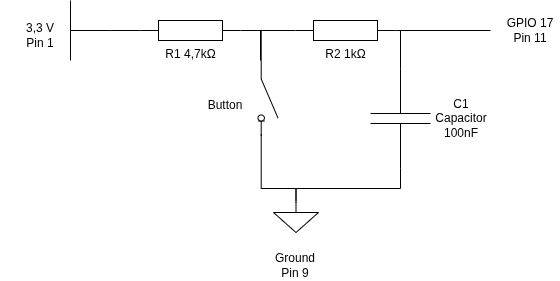

# gophotobooth

A photo booth application for Raspberry Pi 5, built as Go microservices communicating over gRPC and packaged in containers.

## Architecture

Six services in a single Go module (`github.com/chrischdi/gophotobooth`):

| Service | Binary | Description |
|---------|--------|-------------|
| Core | `cmd/core` | Orchestrator. Owns the photo workflow and auto-trigger timer. |
| UI | `cmd/ui` | Fullscreen Fyne display. Receives display commands from Core via gRPC. |
| DSLR | `cmd/dslr` | gphoto2 camera bridge. Called by Core to take a photo. |
| Buzzer | `cmd/buzzer` | Listens for a GPIO button press and calls `Core.Trigger`. |
| Gallery | `cmd/gallery` | HTTP gallery served at an obscure SHA-256-derived URL. |
| ctl | `cmd/ctl` | Admin CLI and stub servers for local testing. |

Proto definitions live in `proto/{core,ui,dslr}/`. Generated `*.pb.go` files are **not** committed — run `make generate` to (re)create them.

### Photo workflow (Core)

```
Startup        → UI.ShowIdle()
Trigger()      → ShowCountdown(3) → sleep 1s
               → ShowCountdown(2) → sleep 1s
               → ShowCountdown(1) → sleep 1s
               → ShowSmile()
               → DSLR.TakePhoto() → write JPEG to --directory
               → UI.ShowImage()
               → sleep --post-capture-seconds   ← blocks next trigger
               → unlock (UI stays on last photo)
```

At most one workflow runs at a time (`sync.Mutex.TryLock`). A concurrent `Trigger` call returns `codes.AlreadyExists`.

## GPIO Circuit

The buzzer button is connected to the Raspberry Pi 5 via a simple RC debounce circuit:



- **3.3 V (Pin 1)** is pulled high through **R1 (4.7 kΩ)** and **R2 (1 kΩ)** in series.
- **GPIO 17 (Pin 11)** is read by the buzzer service; it detects a falling edge when the button is pressed.
- **C1 (100 nF)** is placed between GPIO 17 and ground to filter switch bounce.
- The button connects the node between R1 and R2 to **Ground (Pin 9)**.

The internal pull-up/pull-down resistors of the Raspberry Pi GPIO are **not used**; the external resistor network provides the pull-up and debounce filtering.

The pin name is configurable via the `--pin` flag on the buzzer binary (default: `GPIO17`).

## Default ports

| Service | Address |
|---------|---------|
| Core | `localhost:50000` |
| UI | `localhost:50001` |
| DSLR | `localhost:50002` |
| Gallery HTTP | `0.0.0.0:8080` |

## Build & development

### Prerequisites

- Go 1.26.1
- `protoc` + `protoc-gen-go` + `protoc-gen-go-grpc` (for proto regeneration)
- `libgphoto2-dev` and X11/OpenGL headers (for CGO binaries, only needed on the build host)
- `golangci-lint`

Install the protoc plugins:

```bash
go install google.golang.org/protobuf/cmd/protoc-gen-go@latest
go install google.golang.org/grpc/cmd/protoc-gen-go-grpc@latest
```

### Common commands

```bash
make generate      # Regenerate *.pb.go from proto files
make build         # Build all binaries to bin/ (host arch)
make build-arm64   # Cross-compile for Raspberry Pi 5 (arm64)
make test          # go test ./...
make vet           # go vet ./...
make image         # Build all container images via podman
```

CGO-free services can always be built with `CGO_ENABLED=0 go build ./cmd/<service>`.

### Proto changes

Edit the `.proto` file, then run:

```bash
make generate
# or
./proto/regen.sh
```

Never edit `*.pb.go` files by hand.

## Testing locally without hardware

Use `ctl` stub servers to replace real hardware:

```bash
# 1. Stub UI (no display needed)
./bin/ctl ui-serve-dummy

# 2. Dummy DSLR (generates timestamp images)
./bin/ctl dslr-serve-dummy

# 3. Core
./bin/core --directory /tmp/photos

# 4. Trigger a workflow
./bin/ctl core-trigger
```

### ctl commands

| Command | Target | Description |
|---------|--------|-------------|
| `core-trigger` | Core | Trigger a photo workflow |
| `core-serve-dummy` | Core | Stub Core server (buzzer isolation) |
| `ui-show-idle` | UI | Send ShowIdle |
| `ui-show-image <file>` | UI | Send a JPEG to the display |
| `ui-serve-dummy` | UI | Stub UI server (no display needed) |
| `dslr-serve-dummy` | DSLR | Dummy DSLR returning timestamp images |

## Deploying to Raspberry Pi

### 1. Build the package

```bash
make package          # builds arm64 images + ctl binary, outputs dist/gophotobooth-arm64.tar.gz
```

On an x86_64 host this requires binfmt_misc support for aarch64:

```bash
docker run --privileged --rm docker.io/tonistiigi/binfmt --install arm64
```

### 2. Prepare an env file

Copy `env.sample` and fill in your values:

```bash
cp env.sample my.env
# Set at minimum:
#   GALLERY_BASE_URL   — public URL of the gallery (e.g. https://photos.example.com)
#   CLOUDFLARED_TOKEN  — Cloudflare Tunnel token
#   WIFI_SSID_1 / WIFI_PASSWORD_1 (and _2, _3, …) — WiFi networks to pre-configure
```

### 3. Flash the SD card / SSD

```bash
bash scripts/flash-raspberrypi-os.sh /dev/sdX \
    --package dist/gophotobooth-arm64.tar.gz \
    --env my.env \
    --hostname fotobox \
    --user pi raspberry
```

The script will:

1. Download the latest Raspberry Pi OS Lite (arm64) image
2. Flash it to the device
3. Resize partition 2 (ext4 root) to 32 GiB
4. Create partition 3 (exFAT, remaining space) for photo storage, mounted at `/data`
5. Inject a `firstrun.service` that runs `install.sh` on first boot
6. Write `userconf.txt`, enable SSH, and apply `config.txt` tweaks

Additional options:

| Option | Description |
|--------|-------------|
| `--hostname <name>` | System hostname (default: `fotobox`) |
| `--user <username> <password>` | OS user account (default: `pi` / `raspberry`) |
| `--env <file>` | Env file placed on the boot partition as `gophotobooth.env` |
| `--keep-image` | Keep the downloaded `.img.xz` in `/tmp` after flashing |

### 4. First boot

Insert the SSD into the Raspberry Pi 5 and power it on. `install.sh` runs automatically via `firstrun.service` and sets up all services. Monitor progress over SSH:

```bash
journalctl -u firstrun -f
```

## Public access via Cloudflare Tunnel

The gallery is exposed publicly through a **Cloudflare Tunnel** (no open ports on the Pi):

- `cloudflare/cloudflared` runs as `photobooth-cloudflared.service`
- Enabled by setting `CLOUDFLARED_TOKEN` in `/etc/gophotobooth/env`
- The tunnel token is obtained from **Cloudflare Zero Trust → Networks → Tunnels**
- In the tunnel's Public Hostnames tab, configure: `photos.example.com` → `http://localhost:8080`
- Set SSL/TLS mode to **Full** in the Cloudflare dashboard (tunnel leg is already encrypted)
- `GALLERY_BASE_URL` in the env file should be set to the public hostname (e.g. `https://photos.example.com`) so Core builds correct QR codes

## Linting

```bash
golangci-lint run ./...
```

CI runs `golangci-lint` on every pull request. Fix all lint errors before merging.

## CI (GitHub Actions)

Every PR must pass:

1. `make generate` — verify proto stubs are up to date
2. `go vet ./...`
3. `golangci-lint run ./...`
4. `CGO_ENABLED=0 go build ./cmd/core ./cmd/buzzer ./cmd/gallery ./cmd/ctl`
5. `make test`

CGO binaries (`cmd/dslr`, `cmd/ui`) are only built in CI if the runner has the required system libraries installed.
